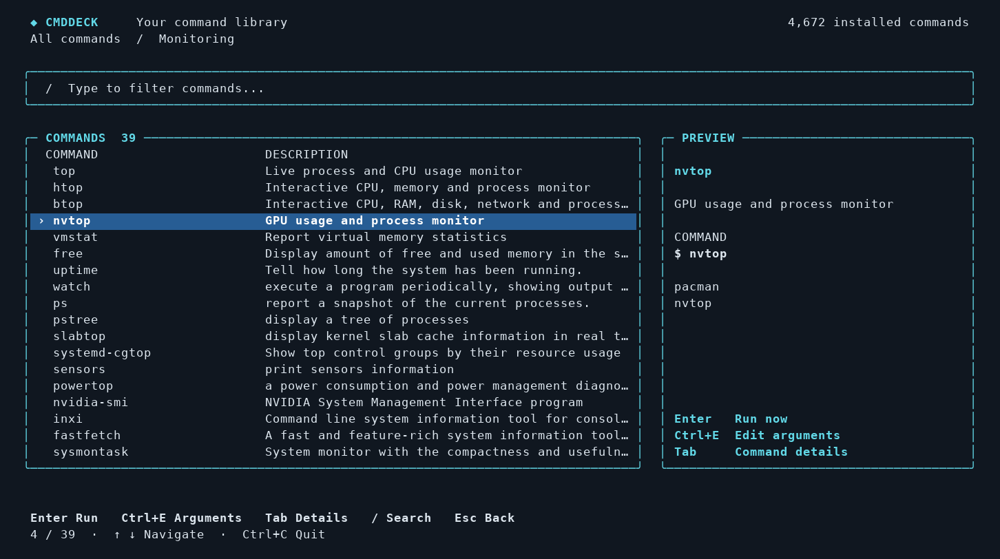

# cmddeck

[](https://github.com/ghahramani/cmddeck/actions/workflows/ci.yml)
[](https://github.com/ghahramani/cmddeck/releases/latest)

**Browse, search, and launch your installed commands.**

Can't remember which command monitors your GPU, finds large files, or manages
containers? Open cmddeck, choose a category, and explore the commands already on
your machine. Select one and press **Enter** to run it.



- Commands grouped by purpose, with descriptions and similar commands.
- Instant filtering and search across command names, packages, and descriptions.
- **Enter** runs immediately; **Ctrl+E** opens an optional argument editor.
- A preview panel, clear keyboard hints, and a layout that adapts to your terminal.
- One statically linked Go binary. No runtime dependencies or companion files.

## Install

Download an archive from [GitHub Releases](https://github.com/ghahramani/cmddeck/releases/latest):

| Your Linux machine | Archive |
| --- | --- |
| x86-64 PC or server | `cmddeck_<version>_linux_amd64.tar.gz` |
| ARM64 machine | `cmddeck_<version>_linux_arm64.tar.gz` |

Extract it, then install the single executable:

```sh
tar -xzf cmddeck_<version>_linux_amd64.tar.gz
install -Dm755 cmddeck "$HOME/.local/bin/cmddeck"
cmddeck
```

Use the ARM64 archive for ARM64 machines. Release downloads include `SHA256SUMS`
for verifying the archives. `~/.local/bin` must be in your PATH. You can also copy
the executable into any other directory in PATH; that one file is the complete
installation.

## Use

```sh
cmddeck                       # browse categories
cmddeck monitor               # open Monitoring directly
cmddeck --search gpu          # search every visible command
cmddeck --list network        # print the Networking category
cmddeck --stats               # inventory and category counts
cmddeck --refresh             # force a fresh inventory
cmddeck --json                # export the command inventory
cmddeck --all --json          # include basic system commands
```

| Key | Action |
| --- | --- |
| ↑ / ↓, Page Up / Down | Move through the list |
| Enter | Open a category, or run the selected command |
| Ctrl+E | Edit arguments and run |
| Tab or → | Show command details |
| Type | Filter the current list |
| / from categories | Search all commands |
| Esc | Clear the search or go back |
| Ctrl+U | Clear the current search or argument input |
| Ctrl+C | Quit the browser |

Arguments support quoting, cursor movement, and inline validation. They are
remembered per command for the current session. After a command finishes, its
output stays visible: Enter returns to the browser, Ctrl+R reruns it, and Ctrl+E
edits its arguments. `h` on a command's details screen opens its `--help`.

Browsing and opening details do not execute commands. Launches pass arguments
directly to the selected executable; shell substitution, operators, variable
expansion, and globbing are not evaluated. Commands that require privileges
follow their normal behavior; cmddeck does not automatically add `sudo`.

## What gets discovered

cmddeck scans executables in your current PATH, respecting the first executable
with each name. This includes local commands, Homebrew, Cargo, SDKs, Flatpak
launchers, and commands supplied by package dependencies. Duplicate PATH
directories and aliases such as `/bin` and `/usr/bin` are collapsed.

On Arch/Garuda, local pacman metadata supplies package ownership and descriptions.
Installed man pages and embedded rules provide more descriptions. Other Linux
distributions still get command discovery, man pages, and command rules; package
ownership currently supports pacman only. Shell aliases, builtins, functions,
and applications without an executable in PATH are outside the inventory.

Basic Unix commands are hidden by default. Useful comparison commands such as
`top`, `free`, and `watch` remain in their purpose categories. Use `--all` to show
the rest. Commands without a confident classification remain visible in Other
installed commands. Categories can be corrected with optional config.

## Customize

Create `~/.config/cmddeck/config.json`, or pass `--config FILE`:

```json
{
  "exclude": ["unwanted-helper"],
  "commands": {
    "my-script": {
      "category": "system",
      "description": "My hardware helper"
    }
  }
}
```

`cmddeck --stats` lists category IDs. An override can expose a normally hidden
command. `XDG_CONFIG_HOME` and `XDG_CACHE_HOME` are respected. Existing config
under `~/.config/command-catalog/config.json` is also recognized when the new
location is absent. No config file is required.

The optional inventory cache lives at `~/.cache/cmddeck/inventory-go.json`.
It refreshes after six hours, or when PATH directories, the pacman database,
config, or embedded rules change. Use `--refresh` after an in-place upgrade;
`--no-cache` disables cache reads and writes. `NO_COLOR` disables browser colors.

## Build and test

Requires Linux and Go 1.23 or later to build. Uses only the standard library.

```sh
CGO_ENABLED=0 go build -buildvcs=false -trimpath -ldflags='-s -w' -o bin/cmddeck .
go test -buildvcs=false ./...
go vet -buildvcs=false ./...
install -Dm755 bin/cmddeck "$HOME/.local/bin/cmddeck"
```

The terminal tests exercise actual execution, quoted arguments, cancellation,
rerunning, search, and terminal restoration through a pseudo-terminal.
`rules.json` is embedded at build time; edit it and rebuild to update the default
classifications.

## Releases

Pushing a version tag runs `.github/workflows/release.yml`, tests the code,
cross-compiles static Linux binaries for AMD64 and ARM64, and publishes a GitHub
Release with archives and checksums:

```sh
git tag -a v2.2.0 -m "Release v2.2.0"
git push origin v2.2.0
```

The workflow can also be started manually for an existing version tag. Published
releases are kept intact on reruns. Build the same archives locally with
`bash scripts/build-release.sh v2.2.0`.
